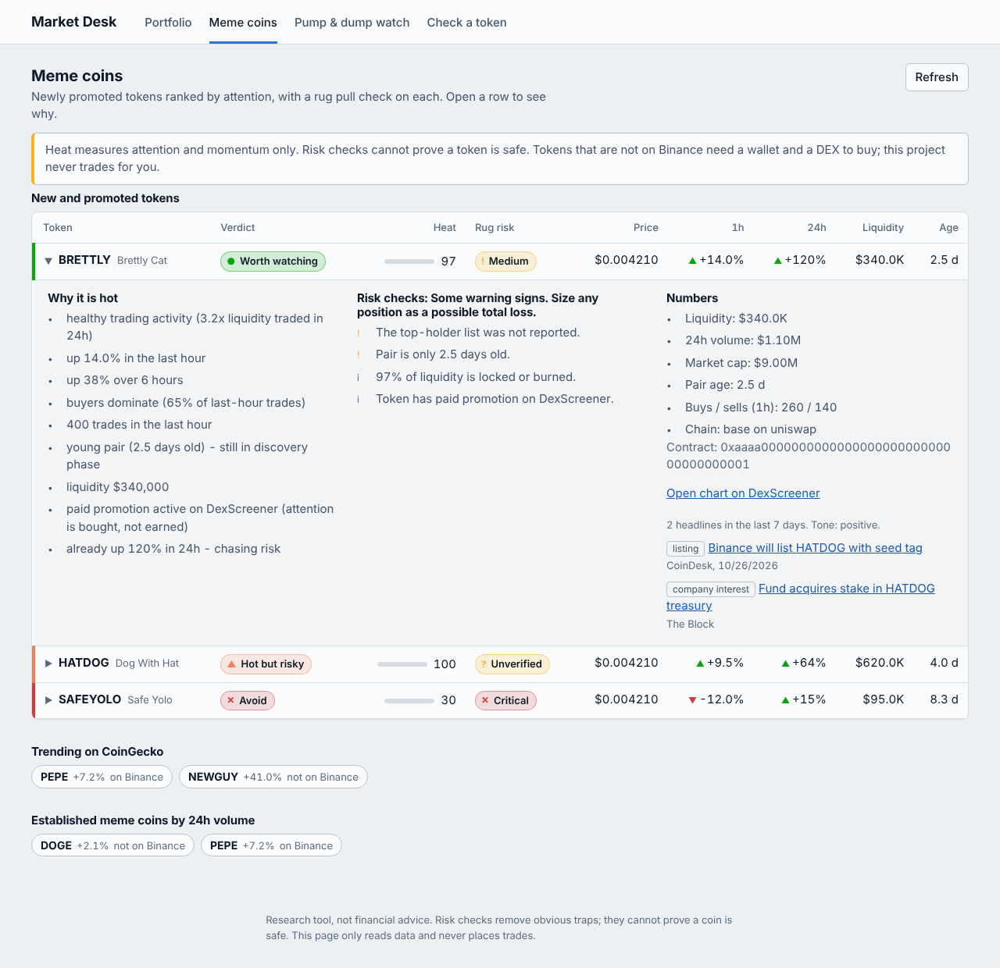
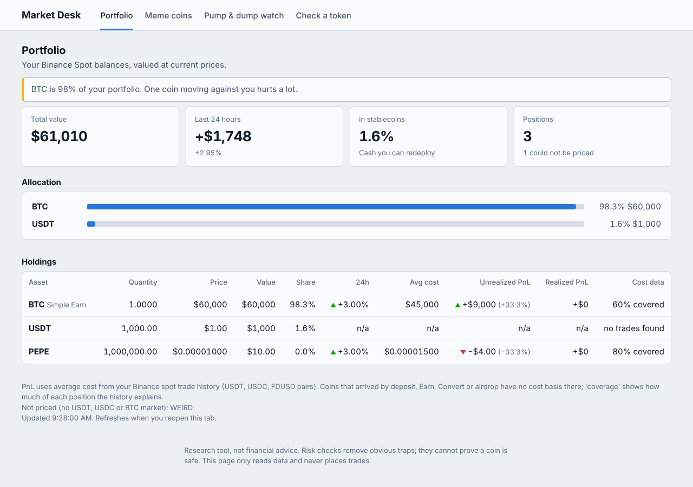
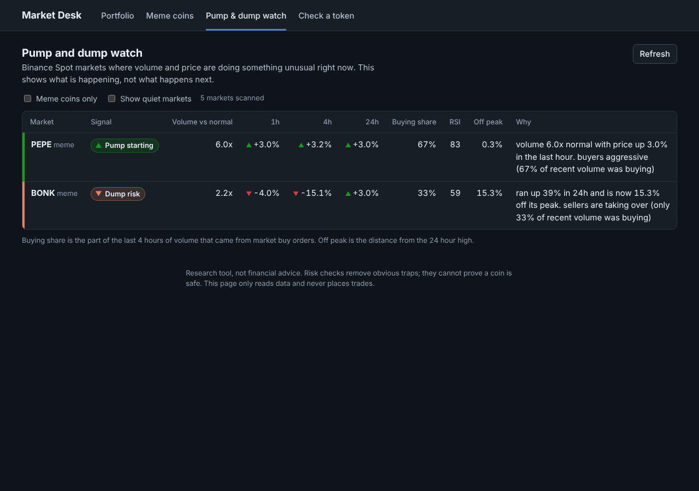
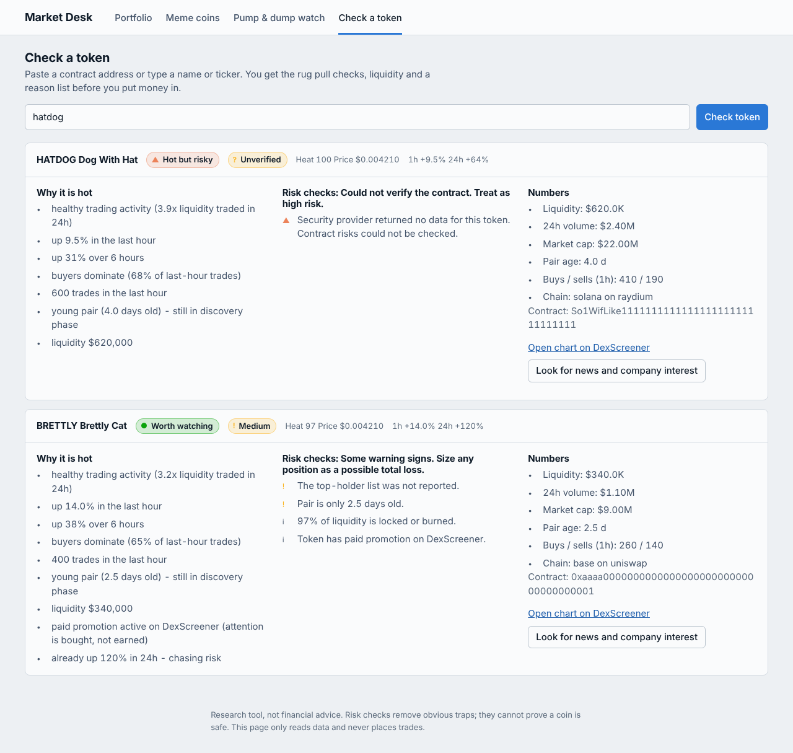
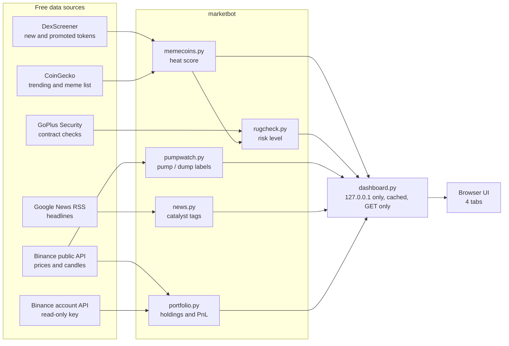

<div align="center">

# 🛰️ Binance Market Intelligence Bot

### Market Desk: see what is hot, what is a trap, and what you actually hold. In one local dashboard.


**Trending meme coins** · **Rug pull checks** · **Pump & dump watch** · **Binance portfolio** · **News & company interest**

</div>

> [!WARNING]
> Research software, not financial advice. Nothing here can predict which coin will pump, and meme coins can go to zero even when every check passes. The project **never places live trades and never says "buy"**.

---

## 📸 What it looks like

> Screenshots use **simulated data** (the build environment has no live market access). Your dashboard shows real data.

<table>
<tr>
<td width="50%"><b>Meme coins</b>: heat, rug risk, reasons, news<br></td>
<td width="50%"><b>Portfolio</b>: value, allocation, average cost, PnL<br></td>
</tr>
<tr>
<td width="50%"><b>Pump &amp; dump watch</b> (dark mode)<br></td>
<td width="50%"><b>Check a token</b>: paste any name or contract address<br></td>
</tr>
</table>

---

## 🚀 Quick start

Needs **Python 3.11+**.

```bash
git clone https://github.com/luciferalive/binance-market-intelligence-bot.git
cd binance-market-intelligence-bot
python -m venv .venv
source .venv/bin/activate            # Windows PowerShell: .venv\Scripts\Activate.ps1
pip install -e ".[dev]"

python -m marketbot dashboard        # then open http://127.0.0.1:8765
```

The **Meme coins**, **Pump & dump** and **Check a token** tabs work immediately with no keys. The **Portfolio** tab turns on after you add a read-only Binance key (see [Portfolio setup](#-portfolio-setup-read-only)).

---

## 🗺️ What was added and why

You asked for a bot that shows what is trending, which meme coins are worth a look, which are traps, what might pump or dump, your Binance portfolio, and why a coin is moving. Here is what each ask became:

| You wanted | What you get | Where in the dashboard | Code |
| --- | --- | --- | --- |
| *What's trending / which meme coin is worth buying* | New and promoted tokens ranked by a transparent **heat** score, with a reason list. CoinGecko trending and established meme coins, marked "on Binance" or not | **Meme coins** | `memecoins.py` |
| *Rug pull things* | A **rug risk** level from contract checks and market checks. Unknown data never counts as safe | **Meme coins**, **Check a token** | `rugcheck.py` |
| *Which can pump, which can bump* | Binance markets labelled **Pump starting / Building / Already extended / Dump risk / Dumping** | **Pump & dump watch** | `pumpwatch.py` |
| *Handle my Binance portfolio in a dashboard* | Balances, total value, 24h change, allocation, average cost, realized and unrealized PnL, concentration warnings | **Portfolio** | `portfolio.py` |
| *Reasons / any company looking into it* | Recent headlines tagged as listing, partnership, company or fund interest, or negative news | A button on every token | `news.py` |
| *A dashboard* | One local web page with four tabs, light and dark mode, works on a phone-sized screen | `python -m marketbot dashboard` | `dashboard.py`, `web/` |

Everything from the original project (scanner, backtester, paper trader, Binance Demo trader) is untouched and still works.

---

## 🧩 How it fits together



**Two numbers on purpose.** *Heat* only measures attention and momentum. *Rug risk* only measures danger. A coin can be hot and a trap at the same time, and the dashboard shows both side by side instead of blending them into one flattering score.

---

## 🔥 Meme coins tab

**Where tokens come from.** DexScreener's currently boosted, newly boosted and newly profiled tokens. Pools under $20K liquidity or $50K 24h volume are dropped. For each token the most liquid pair is used.

**Heat score (0 to 100).** Built from visible pieces, and each one appears in the "Why it is hot" list:

| Signal | Effect |
| --- | --- |
| Volume traded vs liquidity in 24h | Healthy turnover adds points. Extreme turnover adds few (it can mean wash trading) |
| 1h and 6h price change | Rising adds points. Already extreme (1h above 40%) adds fewer |
| Buyers vs sellers, last hour | Buyer-dominated adds, seller-dominated subtracts |
| Trade count, last hour | More activity adds |
| Pair age | Young but past the first hours adds ("still in discovery") |
| Liquidity depth | Deeper adds |
| Paid promotion on DexScreener | Small add, and labelled as bought attention |
| Already up 100%+ or 300%+ in 24h | **Subtracts** (chasing risk) |

**Verdict labels.** `Worth watching` (hot and low or medium risk), `Hot but risky`, `Skip`, `Avoid`. There is deliberately no "Buy".

---

## 🛡️ Rug pull checks

Contract data comes from GoPlus Security (EVM chains and Solana). Market data comes from DexScreener.

| Level | Meaning |
| --- | --- |
| ✕ **Critical** | A hard red flag: honeypot (you cannot sell), cannot sell full balance, owner can change balances, self-destruct, sell tax of 50% or more, hidden owner who can take ownership back |
| ▲ **High** | Sell tax above 10%, hidden owner, ownership can be reclaimed, under 50% of liquidity locked or burned (pool can be drained), mint or freeze authority still active, **or any two high-severity flags together** |
| ? **Unverified** | The security provider returned nothing, or left out key fields (honeypot status, taxes, source verification). Treated as high risk |
| ! **Medium** | Some warning signs, or missing holder or liquidity-lock data |
| ✓ **Low** | None of the checks we can run found a problem. **Not a safety guarantee** |

Other things it flags: closed-source contract, proxy (logic can be swapped), pausable transfers, changeable tax, blacklist function, top-10 wallets holding over 30% or 50% (pool, burn and locked wallets excluded), creator holding over 10%, few holders, thin liquidity, brand-new pair, liquidity tiny compared with valuation, 2:1 sell pressure.

**Design rules, enforced by tests:**
1. **Unknown is not safe.** Missing, `null` or blank data raises risk and can never produce Low.
2. **One serious flag cannot be averaged away** by clean fields elsewhere.
3. **Hard failures override the score.**
4. **Bad provider data fails closed.** A malformed record becomes Unverified for that token instead of crashing the whole scan.

---

## 📈 Pump & dump watch

Reads the last 60 hourly candles for the most active Binance USDT markets, plus known meme coins. Leveraged tokens and stablecoins are skipped. Only closed candles are used.

| Label | Rule of thumb |
| --- | --- |
| ▲ **Pump starting** | Volume 2.5x normal or more, price up 1.5% to 12% in the last hour, 54%+ of recent volume from market buys |
| ◔ **Building** | Volume 1.8x normal, up 3%+ over 4 hours, buyers ahead |
| ! **Already extended** | Up 25%+ in 24h, or RSI 80+ after a 10%+ day. Late entries are where most people lose |
| ▼ **Dump risk** | Big recent run (20%+) now 6%+ off its peak or falling, with sellers taking over or heavy volume |
| ▼ **Dumping** | Down 8%+ in an hour on 2x normal volume |
| – **Quiet** | Nothing unusual (hidden by default) |

These describe what is happening now. They do not say what happens next.

---

## 💼 Portfolio setup (read-only)

1. In Binance open **Account → API Management** and create a key.
2. Turn on **Enable Reading** only. Leave trading, withdrawals and transfers **off**. Restrict the key to your IP address.
3. Copy `.env.example` to `.env` and fill in:
   ```
   BINANCE_API_KEY=your_read_only_key
   BINANCE_API_SECRET=your_secret
   ```
4. Restart the dashboard. `.env` is git-ignored, so it never reaches GitHub. **Never paste your key or secret into a chat or an issue.**

**How your account is protected:**

| Safeguard | What it does |
| --- | --- |
| GET-only client | The portfolio code has no order, transfer or withdrawal functions at all, so a bug elsewhere cannot trade or move funds |
| Withdrawal check | On every load it asks Binance what the key can do and **refuses to continue if withdrawals are on**, or if Binance does not say |
| Permission warnings | Warns about trading, margin, futures, transfer rights and a missing IP allowlist |
| No leaks | The key is never printed, logged, put in error text, or sent in a URL. The key header is never sent along a redirect |
| Local only | The dashboard listens on `127.0.0.1` only |

**How PnL is computed.** Average cost from your Binance spot trade history (USDT, USDC and FDUSD pairs, merged by coin). Coins that arrived by deposit, Earn, Convert or airdrop have no trade record, so each row shows a **coverage %**: how much of your position the history explains. Simple Earn balances (`LDBTC`) are merged into the underlying coin.

---

## 🔒 Dashboard security model

- Binds to `127.0.0.1` or `localhost` and **refuses any other address** (there is no login).
- Rejects requests whose `Host` header is not local (blocks DNS-rebinding), and rejects cross-site browser requests.
- Only `GET` is served.
- Strict Content-Security-Policy: no inline scripts or styles. Token names and headlines come from strangers, so the page inserts them as plain text and never as HTML. Links are `https://` only, and DexScreener links are built by the server rather than copied from token data.
- Panels are cached for 45 seconds to 10 minutes, and the cache has a size limit, so free API rate limits are respected.

---

## ⌨️ Commands

Everything in the dashboard also works from the terminal:

| Command | What it does |
| --- | --- |
| `python -m marketbot dashboard` | Open the web dashboard (`--port 8765`) |
| `python -m marketbot memes --top 15` | Trending meme coins with rug checks |
| `python -m marketbot check PEPE` | Rug check for one token. Also accepts a contract address |
| `python -m marketbot pumps --memes-only` | Pump and dump watch (`--all` includes quiet markets) |
| `python -m marketbot news "Bonk"` | Recent headlines and catalyst tags |
| `python -m marketbot portfolio` | Print your portfolio (`--no-pnl` is faster) |
| `python -m marketbot scan` | Original technical signal scanner |
| `python -m marketbot backtest FILE.csv` | Original backtester |
| `python -m marketbot paper` / `paper-status` | Original local paper simulator |
| `python -m marketbot demo-balance` / `demo-order` / `demo-auto` | Original Binance Spot **Demo** trading |

Add `--json` to `memes`, `check`, `pumps`, `news` and `portfolio` for machine-readable output.

---

## 🌐 Data sources

All free, none need a key (CoinGecko optionally takes a free demo key in `.env` as `COINGECKO_API_KEY` for a higher limit).

| Source | Used for |
| --- | --- |
| DexScreener | New and promoted tokens, pair liquidity, volume, trades, age |
| GoPlus Security | Contract security: honeypot, taxes, mint and owner powers, holders, liquidity locks |
| CoinGecko | Trending coins and the meme-token category |
| Google News RSS | Headlines for the catalyst tags |
| Binance public API | Prices, 24h tickers and candles |
| Binance account API | Your balances and trade history (read-only key) |

---

## 🗂️ Project layout

```
src/marketbot/
├── dashboard.py        local web server and caching
├── web/                index.html · app.css · app.js (no framework, no build step)
├── memecoins.py        DexScreener and CoinGecko, heat score
├── rugcheck.py         rug pull risk engine
├── pumpwatch.py        pump and dump classifier
├── portfolio.py        read-only Binance client, valuation, cost basis
├── news.py             headline fetch and catalyst tags
├── binance_public.py   public Binance helpers
├── net.py              small HTTP helper: retries, no secrets in errors
├── settings.py         .env loader
└── (original)          scanner · strategy · backtest · paper · binance_demo · demo_trader · risk · indicators
tests/
├── test_intel_core.py      HTTP helper, rug check, meme scoring, news
├── test_intel_market.py    pump labels, portfolio, dashboard server
└── (original tests)
docs/                   screenshots, roadmap, Binance Demo notes
```

---

## 🧪 Tests

```bash
pytest -q
ruff check src tests
```

72 new tests cover the risk engine (including the cases where risky tokens must never read as Low), pump labels, portfolio math (cost basis, fees, positions that partly left the account, trades across quote pairs), key safety (withdrawal-enabled keys are refused), and the dashboard's host and cross-site checks. They run on fake data, so no network or keys are needed.

---

## ⚠️ Limits you should know

- **Rug checks remove obvious traps. They cannot catch** social-engineering rugs, brand-new exploits, or insiders who sell slowly from fresh wallets. Meme coins can go to zero with every check green.
- **News is keyword-tagged headlines.** Anyone can publish a "partnership" headline for a micro-cap, so read the article. No social sentiment, no wallet-level forensics.
- **Tokens that are not on Binance** need a wallet and a DEX to buy. This project never trades for you.
- **Pump labels describe the present.** A coin flagged as starting can reverse the next hour.
- **PnL covers only what your spot trade history explains.** Check the coverage column.
- Free data sources have rate limits and can be down. The dashboard shows a notice for any missing source instead of hiding it.
- Strategy profitability of the original scanner has not been established.

---

## 🕹️ Original features (still here)

<details>
<summary><b>Technical scanner, backtesting, paper trading and Binance Spot Demo trading</b></summary>

### Scan the market

```bash
python -m marketbot scan --quote USDT --timeframe 1h --top 80 --output reports/signals.csv
```

Ranks eligible Binance Spot pairs by trend (EMA 20/50), momentum (RSI), breakout, relative volume and ATR-based risk levels, and writes WATCH / LONG_SETUP / NO_SETUP signals to CSV. It prioritizes markets by 24-hour quote volume before fetching candles to reduce API load.

### How the scanner's signals are calculated

- **Trend:** EMA 20/50 alignment and price relative to EMA 20
- **Momentum:** RSI range and recent returns
- **Breakout:** close relative to the previous rolling high (current candle excluded)
- **Relative volume:** closed-candle volume against a rolling average
- **Volatility:** ATR as a percentage of price for estimated risk levels

Signals use closed candles only. A high score means the market matches the coded rules. It is not a win probability.

### Connect Binance Spot Demo (fake money)

Create **Binance Spot Demo Trading** credentials (separate from your real key), then:

```bash
export BINANCE_DEMO_API_KEY="your_demo_key"       # PowerShell: $env:BINANCE_DEMO_API_KEY="..."
export BINANCE_DEMO_API_SECRET="your_demo_secret"
python -m marketbot demo-balance
python -m marketbot demo-auto --quote USDT --timeframe 1h --top 50 --interval 300 --max-allocation 1000
```

`--max-allocation` is a cap on the strategy's entry size, not a separate wallet. Read [Binance Spot Demo details and limitations](docs/BINANCE_SPOT_DEMO.md) first. Demo stop and target monitoring is polling-based, not an exchange-hosted stop-loss.

### Backtest and paper trading

`backtest` replays a candle CSV with fees and conservative stop/target handling. `paper` runs a separate local SQLite paper account. See `python -m marketbot --help`.

</details>

Before considering any real-money system, require out-of-sample and walk-forward testing, realistic fees and slippage, fixed-risk position sizing, loss limits, robust order reconciliation, a kill switch and extended demo evaluation. Keep API keys withdrawal-disabled and out of source control. See also [docs/ROADMAP.md](docs/ROADMAP.md).

---

## 📄 License

MIT. See [LICENSE](LICENSE).
